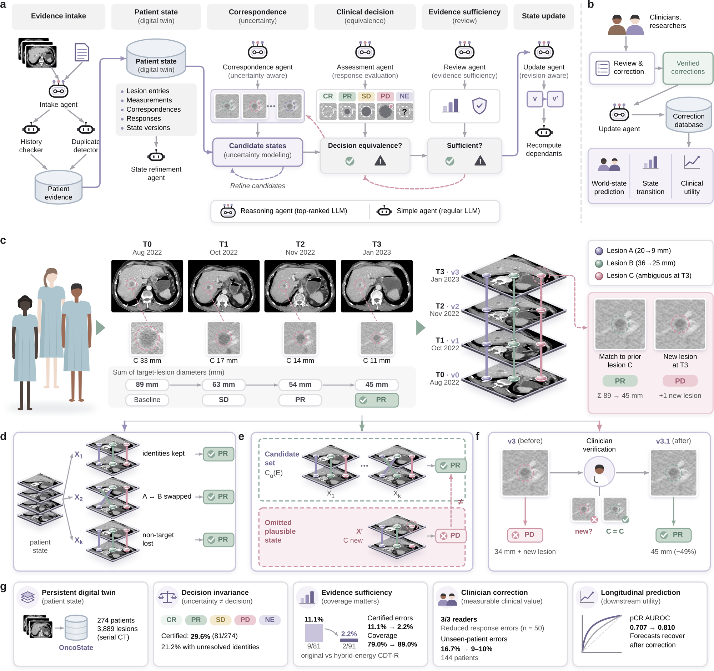

<h1 align="center">OncoState</h1>

  <b>Maintaining evidence-grounded clinical assessments in longitudinal oncology</b> 
  <i>Code release accompanying the manuscript</i>

  
  
  

  

---

## Release checklist

### Core method
- [x] Evidence-linked, versioned patient state with an append-only ledger
- [x] Deterministic RECIST 1.1 clinical-rule service
- [x] Structured correspondence hypotheses and correspondence energy
- [x] Gumbel–Sinkhorn assignment uncertainty
- [x] Patient-level conformal calibration of candidate states
- [x] Clinical decision-equivalence verification (CDT-R, MILP)
- [x] Coverage-aware certification and certificate invalidation
- [x] Counterexample-guided evidence queries

### Clinical review
- [x] Clinician review interface and correction events
- [x] Patient-specific state revision
- [x] Cross-patient matcher updating with a validation gate

### Longitudinal analyses
- [x] CT lesion state, registration and matching
- [x] Agent and vision–language baselines
- [x] Multi-visit assessment consistency
- [x] MRI state synchronization
- [x] State-semantics ablation
- [x] RECIST rule fidelity
- [x] Treatment-response and longitudinal forecasting
- [x] Glioma MRI decision equivalence

### Packaging
- [x] Pinned environments (`environment/`)
- [x] Figure source-data builders (`source_data/`)
- [ ] Data download and preprocessing guide
- [ ] Step-by-step reproduction guide
- [ ] Citation and license

---

Documentation will be completed upon publication.

